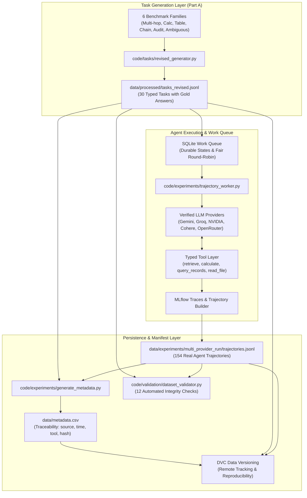

# Data Collection, Provenance & Licensing Note

**Project:** AgentEvalOps (Project 1)  
**Course:** CS 203 Software Tools and Techniques in AI  
**Repository:** `AgentEvalOps`  
**Date:** October 2026  

---

## 1. Consent and Licensing Register

### Data Provenance
All evaluation tasks in this repository (`data/raw/tasks.jsonl` and `data/processed/tasks_revised.jsonl`) are synthetically generated or curated benchmark tasks specifically designed to test tool-using LLM agent reasoning.
- **No Personal Identifiable Information (PII):** All names (e.g. "Rohan Deshmukh", "Aarav Patel"), employee IDs, and company records are fictitious and generated using synthetic distributions.
- **No Private or Proprietary Documents:** All virtual filesystem fixtures (e.g. `consulting_ledger.csv`, `server_metrics.csv`, `logs/cluster_events.json`) are self-contained, synthetic sandbox files.
- **API Terms of Service & Model Usage:**
  - Inference was performed via official free-tier developer APIs (Google Gemini Developer API, Groq Cloud API, NVIDIA NIM Catalog, Cohere Compatibility API, OpenRouter Free Tier, Cloudflare Workers AI).
  - All calls complied strictly with the respective providers' terms of service, rate limits, and non-commercial educational use guidelines. No scraping, account cycling, or terms violations were conducted.

---

## 2. End-to-End Data Flow

The diagram below traces how evaluation tasks and genuine model trajectories move through the system into `metadata.csv` and DVC storage:

---

## 3. Metadata Schema Specification (`data/metadata.csv`)

| Column | Description | Example |
|---|---|---|
| `sample_id` | Unique ID of task or trajectory run | `T1_multihop_01` or `93904b01-96f3-48e6...` |
| `sample_type` | Record type (`task` or `trajectory`) | `task` |
| `source` | Provenance generator or model identifier | `groq:openai/gpt-oss-120b` |
| `timestamp` | ISO 8601 creation/execution timestamp | `2026-10-21T11:00:00Z` |
| `collector` | Module or worker identity responsible | `code.experiments.trajectory_worker` |
| `tool_version` | Pinned software/tool release version | `v1.2.0` |
| `content_hash` | SHA-256 cryptographic digest | `e4f22a554f02da2780f08d2ba0942386...` |
| `extra_metadata` | Structured JSON containing operational attributes | `{"outcome": "error", "steps": 5}` |
