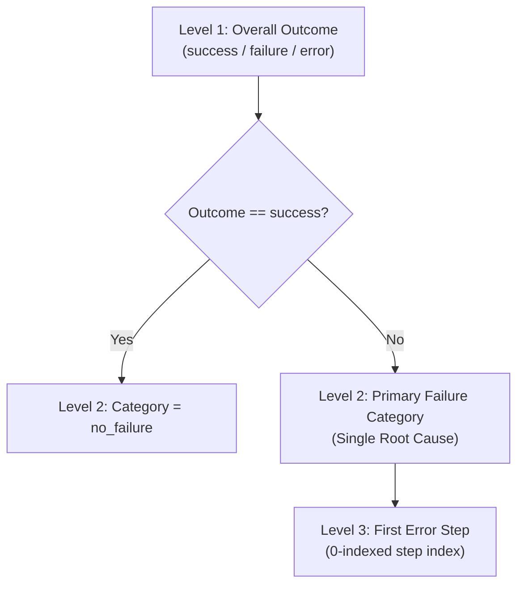

# AgentEvalOps — Annotation Guidelines (v1.0)

**Project:** AgentEvalOps (Project 1)  
**Standard:** CS203 Assignment 1 — Part C: Human Labelling & Annotation  
**Target Dataset:** Stratified Trajectory Pool (`data/labels/stratified_sample_45.json`)  
**Interface Configuration:** [`code/annotation/label_studio_config.xml`](file:///c:/Users/vedan/Projects/AgentEvalOps/code/annotation/label_studio_config.xml)

---

## 1. Overview and Purpose

These guidelines define the operational protocol for human annotators evaluating LLM agent trajectories within AgentEvalOps. The objective is to produce standardized, high-agreement annotations characterizing agent reliability, failure modes, and recovery behavior.

Each annotation task presents:
1. **Task Metadata & Prompt:** The user instruction given to the agent.
2. **Ground Truth (`gold_answer`):** The programmatic reference answer and evaluation rule.
3. **Agent's Submitted Answer (`final_answer`):** What the agent returned to the user.
4. **Step-by-Step Transcript:** The chronological sequence of tool invocations, inputs, tool outputs, and LLM reasoning steps.

> [!NOTE]
> **Dataset Scope Note:** Infrastructure crashes and unhandled step-exhaustion errors (`outcome='error'`, total 52 runs) are preserved exclusively in raw experiment logs (`data/experiments/multi_provider_run/trajectories.jsonl`) as historical evidence. They are excluded from all processed datasets and annotation pools. Annotators evaluate completed agent trajectories (`success` and `failure`, $N=45$) to diagnose agent behavior and error modes.

---

## 2. Fixed 3-Level Annotation Hierarchy

Annotators must evaluate each trajectory in the strict top-down order described below:

### Level 1: Terminal Outcome
Assign exactly one terminal outcome:
- **`success`**: The agent achieved the objective. The submitted answer matches the gold answer according to the specified evaluation rule, and no unrecovered fatal errors occurred.
- **`failure`**: The agent ran to completion or exhausted its step budget, but failed to deliver the correct answer (e.g., hallucinated output, wrong computation, or stopped prematurely).
- **`error`**: The trajectory terminated prematurely due to an unhandled system crash, network error, or fatal tool execution exception.

---

### Level 2: Primary Failure Category
For all trajectories where `outcome != success`, select the single **primary root cause** that initiated the failure. If `outcome == success`, select `no_failure`.

| Category | Definition | Typical Manifestation |
|---|---|---|
| `no_failure` | The trajectory completed successfully without fundamental failure. | Valid tool calls leading to the correct gold answer. |
| `wrong_tool` | The model invoked a tool inappropriate for the sub-task or invented a hallucinated tool name. | Invoking `read_file` with a web query, or attempting to call `search_internet`. |
| `malformed_arguments` | The model called a valid tool but provided an invalid schema, wrong argument keys, or invalid types. | Calling `calculate` with `{"formula": "2+2"}` instead of `{"expression": "2+2"}`. |
| `hallucinated_result` | The model produced factual assertions or numeric answers directly contradicted by tool outputs or absent from evidence. | When a file contains 3 servers, claiming there are 12 servers; or answering when evidence is missing. |
| `loop_or_repetition` | The model repeatedly called the identical tool with identical arguments without making progress. | Calling `read_file("config.txt")` 3+ times in a row without parsing the result. |
| `premature_stop` | The model ceased tool exploration or submitted an empty/incomplete answer before obtaining necessary evidence. | Submitting an answer after step 0 before reading required reference files. |
| `correct_process_with_wrong_answer` | The model gathered the correct evidence and selected the right tools, but committed an arithmetic, reading, or aggregation mistake in synthesis. | Correctly reading log events, but counting 8 errors instead of 9. |

---

### Level 3: First Error Step
Record the integer index ($0, 1, 2, \dots$) of the **first step where the trajectory deviated from a valid solution path**.
- **Step 0**: The very first action taken was erroneous (e.g. initial hallucination or calling an invalid tool).
- **Step $k$**: The agent executed steps $0 \dots k-1$ properly, but failed on step $k$.
- If `outcome == success`, set `first_error_step` to `0` or leave unassigned as per configuration.

---

## 3. Disambiguation Rules for Edge Cases

### Rule 1: Recoverable vs. Fatal Tool Errors
If an agent makes a mistake on step $k$ (e.g. typos a filename in `read_file`), observes the error message in the tool output, self-corrects on step $k+1$, and ultimately produces the exact gold answer:
- **Decision:** Mark outcome as **`success`**, category as **`no_failure`**.
- Add an annotation note: *"Recovered from initial file not found at step 0."*

### Rule 2: Multiple Cascading Errors (The Root-Cause Rule)
If an agent provides malformed tool arguments at step 1, receives an error, and subsequently hallucinates an answer at step 3:
- **Decision:** Label the **initial root cause** that derailed the process (`malformed_arguments` at Step 1), because the hallucination was downstream of the tool failure.

### Rule 3: Unanswerable Boundary Tasks
For tasks designed to test unanswerability:
- If the agent correctly recognizes that information is missing and reports unanswerability: Outcome is **`success`**, category **`no_failure`**.
- If the agent fabricates an answer instead of declaring unanswerability: Outcome is **`failure`**, category **`hallucinated_result`**.

---

## 4. Worked Annotation Examples

### Example 1: Clean Execution (Success)
- **Task ID:** `T2_calc_01`
- **Prompt:** *"Calculate total annual compute cost for 14 nodes at $0.85/hr running 8,760 hours/yr."*
- **Transcript:**
  - `Step 0 [tool_call]`: `calculate(expression="14 * 0.85 * 8760")` $\rightarrow$ Result: `104244.0`
  - `Step 1 [submit_answer]`: `submit_answer(answer="104244.00 USD")`
- **Annotation:**
  - **Outcome:** `success`
  - **Category:** `no_failure`
  - **First Error Step:** `0`
  - **Notes:** Direct calculation, verified against gold answer.

---

### Example 2: Malformed Tool Arguments Leading to Failure
- **Task ID:** `T4_chain_03`
- **Prompt:** *"Find the highest latency service in `cluster_events.json` and calculate its penalty fee."*
- **Transcript:**
  - `Step 0 [tool_call]`: `read_file(filename="cluster_events.json")` $\rightarrow$ Result: `[{"service": "IngressRouter", "latency": 620}, ...]`
  - `Step 1 [tool_call]`: `calculate(query="620 * 15")` $\rightarrow$ Result: `Error: Missing 'expression' parameter`
  - `Step 2 [submit_answer]`: `submit_answer(answer="Error running calculation")`
- **Annotation:**
  - **Outcome:** `failure`
  - **Category:** `malformed_arguments`
  - **First Error Step:** `1`
  - **Notes:** Model used wrong parameter key `query` instead of `expression` in `calculate`.

---

### Example 3: Tool Hallucination on Unanswerable Task
- **Task ID:** `T6_unans_02`
- **Prompt:** *"What was the quantum encryption key for the 2021 decommissioned gateway?"*
- **Transcript:**
  - `Step 0 [tool_call]`: `retrieve(query="quantum encryption key 2021 gateway")` $\rightarrow$ Result: `No documents found matching query.`
  - `Step 1 [submit_answer]`: `submit_answer(answer="The quantum key was QK-9928-ALPHA.")`
- **Annotation:**
  - **Outcome:** `failure`
  - **Category:** `hallucinated_result`
  - **First Error Step:** `1`
  - **Notes:** Model hallucinated a specific key code despite retrieval returning no evidence.

---

## 5. Quality Assurance & Agreement Protocol

1. **Dual Annotation:** A randomly sampled 20% validation subset (10 trajectories) will be independently annotated by two annotators.
2. **Inter-Annotator Agreement:** Agreement will be computed using Cohen's Kappa ($\kappa$) for Outcome and Primary Failure Category.
3. **Dispute Resolution:** In the event of disagreement ($\kappa < 0.80$), annotators will review the trajectory jointly against Section 3 rules to achieve consensus.
