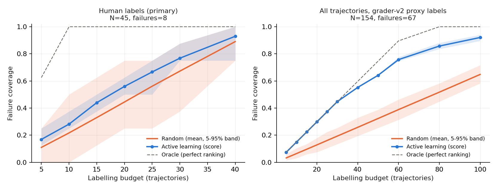

**Repository:** https://github.com/VedantSharan/AgentEvalOps (tag `a1-final`).

Every number carries an evidence ID such as [C3]. Appendix A maps each ID to the file and field that holds it, and `python -m code.reporting.check_report_numbers` re-reads all of them and confirms they match.

# 1. Collection and instrumentation (Part A)

A plain-Python function-calling agent uses five typed tools over a synthetic environment:

- `retrieve`: keyword search over a knowledge base;
- `calculate`: safe arithmetic;
- `query_records`: an employee table;
- `read_file`: virtual CSV and JSON files;
- `submit_answer`.

**Task suite.** 6 template families × 5 instances, 30 tasks in total [A1, A2]. Gold answers are computed by solver functions, and the suite includes 5 ambiguous or unanswerable tasks.

**Collection and Tracing Architecture.** A queue-based worker (`code/experiments/trajectory_worker.py`) ran the agent on 21 Oct 2026 through 5 hosted free-tier APIs and 10 models [A3–A5], at temperature 0 with at most 5 LLM turns. This produced **154 trajectories**. 52 runs were logged as `error`, and 42 ended without a submitted answer [A7, A8]. Each trace stores the task, configuration hash, model and prompt version, every LLM and tool call with arguments, outputs, errors, latency and tokens, and the final answer.

The telemetry system supports two complementary execution modes via MLflow Tracing (`code/tracing/mlflow_tracer.py`):
1. **Synchronous inline tracing (`code/experiments/runner.py`):** Wraps the agent's execution loop directly with `MLflowTracer` for single-agent evaluation benchmarks, generating hierarchically nested spans (agent execution root, LLM calls with token usage and latency, tool invocations with typed arguments/returns, and deterministic grading evaluation) live during execution.
2. **Decoupled batch ingestion (`code/tracing/export_trajectories_to_mlflow.py`):** In batch multi-provider runs across 10 hosted models, `trajectory_worker.py` logged rich trajectories to append-only JSONL files and a durable SQLite queue, intentionally decoupling live API execution from the MLflow SQLite backend (`mlruns/mlflow.db`). This architectural decision eliminated SQLite concurrency lock contention (`OperationalError: database is locked`) during concurrent multi-provider streaming and isolated external API rate-limit backoffs. The offline ingestion adapter faithfully maps the complete telemetry into MLflow traces and spans with zero fabrication. The resulting 174 traces and 633 spans across 43 tasks are inspectable via `mlflow ui`.

**Coverage and Provenance:**

- **Task coverage:** Trajectories cover 20 of the 30 tasks [A6], prioritizing multi-model depth with 6–10 runs per task across 10 hosted models (154 total). This satisfies all annotation, detector, and family-level split requirements, while leaving the remaining 10 tasks as an unexecuted benchmark reserve for Assignment 2.
- `data/metadata.csv` provides complete provenance across all 154 collected trajectories with authentic execution timestamps recovered from the work-queue database, the 30 base benchmark tasks, and all 149 augmented tasks (381 records total).

Data flow: `docs/DATA_COLLECTION.md`.

# 2. Data validation (Part B)

The 12-check suite (`code/validation/benchmark_validator.py`) covers JSON parsing, Pydantic schemas, unique IDs, reference integrity, content hashes, duplicates, answer leakage into prompts, tool determinism, tool-call arguments, metric ranges, missing values and grader consistency.

**Before and after.** Initially the suite failed on answer leakage in `T5_audit_04`; the prompt was fixed (`docs/VALIDATION_REPORT.md`). Saved evidence files:

| Dataset | Checks passed | Checks failed |
|---|---|---|
| Raw (154 runs) | 12/12 [B1] | 0 |
| Processed | 12/12 [B2] | 0 |
| Deliberately corrupted fixtures | 1/12 | 11 [B3] |
| Augmented tasks | 12/12 [B4] | 0 |

**A finding from labelling.** The logged grader (v1) rejected correctly formatted answers, because `float("$25,920")` fails, and it required the literal word "unanswerable". Grader v2 normalises currency, separators, units and sentences, and accepts explicit abstentions:

- correct answers rise from 48 to 87 [B5, B6];
- 39 answers flip from wrong to correct, and 0 the other way [B7, B8].

Its agreement with humans is reported out of sample in Section 3.

# 3. Labelling and agreement (Part C)

**Label levels**, filled in this order (`LABELLING_PROTOCOL.md` §4):

1. `outcome`
2. `primary_failure_category` (7 classes)
3. `first_error_step`

**Rounds.** Two annotators (A1, A2) labelled independently in separate Label Studio projects:

- **Round 1** (guidelines v1): 45 stratified trajectories [C1].
- **Round 2** (guidelines v2): 40 new trajectories [C2]. These were drawn with seed 2026 from the 109 unlabelled runs and deliberately enriched with failures: prevalence 0.625 vs 0.16 [C14, C15].

Both rounds overlap fully.

**Adjudication.** Disagreements (8 in round 1, 19 in round 2 [C18, C19]) were resolved by ADJ1, which is A2 acting as adjudicator:

- Each proposal was drafted with AI assistance from trace evidence. ADJ1 confirmed all 27 and changed 2 [C25].
- Agreed labels were never overridden.
- Result: 85 labelled trajectories, 33 of them failures, 27 adjudicated [C34–C36].

**Table 1. Agreement before and after the guideline revision** (Cohen's κ, scikit-learn; matched by `run_id`)

| Measure | Round 1 (v1) | Round 2 (v2) |
|---|---|---|
| Outcome κ (PABAK) | 0.85 (0.91) [C3, C12] | 0.95 (0.95) [C4, C13] |
| Category κ, all items | 0.45 [C5] | 0.48 [C6] |
| Category κ, items both called failure | 0.05 (n = 7) [C7] | 0.21 (n = 24) [C8, C9] |
| First-error step κ (no failure coded −1) | 0.65 [C10] | 0.87 [C11] |
| Median seconds per item (A1) | 4.2 [C16] | 34.5 [C17] |

{width=58%}

**What changed in v2** (`docs/annotation_guidelines_v2.md`, changes table):

- `wrong_tool` restricted to tools that *cannot* supply the information;
- `malformed_arguments` = the tool rejected the arguments;
- a first-deviation rule for the step, left empty on success;
- a rule for valid but unproductive calls;
- format-insensitive correctness;
- the grader verdict hidden from annotators.

**Results.** Outcome and step agreement improved. Category agreement on genuine failures improved, but stays low.

**Caveats:**

- κ depends on prevalence, and round 2 has about 4× more failures, so we also show PABAK and the both-failure subset.
- A post-hoc 4-class merge of the taxonomy helps only slightly (0.28 [C37]). The disagreement is systematic between annotators: A1 used `wrong_tool` 6 times, A2 never; A2 used `correct_process_with_wrong_answer` 7 times, A1 never [C38–C40].

**Disagreements.** All 27 are discussed with trace evidence in Appendix C; three recurring patterns, plus one gap in agreed labels:

1. `wrong_tool` vs `malformed_arguments` when `query_records` is asked for fields it does not have.
2. "Step-limit wandering": the answer was found and never submitted.
3. Step disagreements where an annotator marked where the run *ended*, not where it went wrong.
4. **Gap in agreed labels:** three empty submissions on unanswerable tasks were labelled success by both annotators.

v3 recommendations: `docs/annotation_findings.md` §5.

**Human vs grader.** In round 1, the humans corrected 13 runs that grader v1 had logged as failures [C20]. On round 2, which grader v2 had never seen, agreement with humans is κ 0.83 and 0.78, against 0.52 and 0.48 for v1 [C21–C24].

**Automatic detectors vs human primary labels** (`supporting_files/detectors/`):

- **Malformed calls.** "The tool rejected the arguments" (file-not-found excluded) reaches precision 0.89, recall 0.80, κ 0.82 [C26–C28]. Against each annotator separately it scores κ 0.40 (A1) and 0.88 (A2) [C29, C30].
- **Loops.** "≥3 identical calls" finds only 0.25 of the human-labelled loops [C31]. Adding "step limit without an answer" finds all of them, at precision 0.29 [C32, C33]. Most false positives are real events that humans did not choose as the *primary* cause.

**Gold test set:** frozen in Part E.

# 4. Augmentation and active learning (Part D)

We built 149 augmented tasks [D1]. Every one comes with an executed check, not just code; all checks pass [D5–D7].

1. **Entity and parameter variants** (23) [D2]. Gold answers are recomputed by the original solver functions. Each variant's evidence is then confirmed reachable by calling the real tools. This check *rejected* 3 plausible candidates whose facts the tools cannot reach [D8].
2. **Paraphrases** (30) [D3]. Rule-based and seeded. A protected-span check (numbers, IDs, quoted names, acronyms, logic words) must match exactly, and negative tests show it catches dropped or added conditions. In a human spot check, 10/10 paraphrases kept their intent [D10].
3. **Fault injection** (96) [D4]. A wrapper around the real tool registry injects four faults: transient failure, outage, +2 s latency, and changed output format. Each fault is checked to behave as specified:
   - Format changes carry identical canonical content.
   - An **information outage** takes down all three information tools, so the expected behaviour *changes* to abstaining. 19 tasks are re-labelled unanswerable this way [D9].
   - A calculator outage keeps the gold answer, because the arithmetic can be done by hand.
   - Faults never mark themselves in tool output. Injected faults are identified by the task's fault spec and the injector log.

No agent runs were made on augmented tasks (no API keys).

**Active learning vs random.** Selection is by a label-free score: normalised step count + repeated identical calls + tool errors. It is compared with random selection on the same 85 human-labelled trajectories (33 failures [D23]), with 1,000 seeded trials [D24] and the same budgets and metric.

| Budget | Failure coverage, active learning | Failure coverage, random (mean) |
|---|---|---|
| 10 | 0.29 [D11] | 0.12 [D12] |
| 20 | 0.43 [D13] | 0.24 [D14] |
| 30 | 0.55 [D15] | 0.35 [D16] |

Random selection matched active learning in at most 0.1% of trials [D17].

{width=95%}

**What the curve shows:**

- The score finds failures faster, but it favours long, error-heavy runs. 13 of its top 30 never submitted an answer [D20], so random selection finds *more distinct categories* at budget 30 (0.79 vs 0.67 [D18, D19]).
- On the proxy pool the gap is larger (0.45 vs 0.19 at budget 30 [D21, D22]), but this is partly trivial: many picks are runs without an answer.
- The labelled pool is not a random sample, because round 2 was enriched with failures.

# 5. Versioning and splits (Part E)

**Splitting unit:** template family; assignment is deterministic. The repository's own plan put T1–T3 in train, T4 in validation and T5 in test. It called T6 "stratified", which would place one family in several splits, so the whole of T6 goes to test.

| Split | Families | Trajectories |
|---|---|---|
| train | 3 families | 78 [E1] |
| validation | 1 family | 32 [E2] |
| test (gold) | 2 families | 44 trajectories, 24 human-labelled [E3, E4] |
| shifted | 96 fault-injected tasks [E5] | evaluation only |

**What follows its parent's split:** variants, repeated runs and labels.

**Ten automatic checks pass** [E6]. They test that families are disjoint, that no item and no identical prompt is in two splits, that each item has the right parent, that the shifted split equals the fault-injected tasks, that every manifest row's hash matches its source record, that every data file is either split or excluded with a reason, and the gold checksums. Negative tests confirm each check fails on a tampered manifest.

**Gold-set SHA-256:**

- `gold_tasks.jsonl` `f4b15d31…` [E7]
- `gold_labels.csv` `72e8f84f…` [E8]

**DVC.** Raw inputs are tracked with `dvc add`. A 14-stage `dvc.yaml` rebuilds every derived file, byte-identical in testing, and pushes to a local remote. Human inputs (raw exports, signed adjudications, spot check) stay in git. The repository is tagged `a1-final` (`HANDOFF_A2.md` §6).

# 6. Dataset card, software and labelling protocol (Part F)

**Dataset card** (`docs/DATASET_CARD.md`):

- 30 synthetic tasks;
- 154 trajectories from 10 hosted models;
- 85 human labels: 52 success and 33 failures, mostly correct-process-wrong-answer (11) and malformed arguments (10) [F1–F3];
- 149 augmented tasks.

**Known biases:**

- uneven model coverage (2 to 20 runs per model) [F4, F5];
- 10 tasks never run;
- non-random labelled samples;
- noisy categories;
- an adjudicator who is also an annotator;
- a keyword-only `retrieve` tool that shapes the observed failures.

**Software** (`ENVIRONMENT.md`):

- Python 3.10.12 on Ubuntu 22.04.5;
- DVC 3.67.1;
- Label Studio 1.23.2 (round 2; the round-1 version was not recorded).

All packages are pinned (`requirements.txt`), with the full freeze in `requirements_freeze.txt`. No GPU or local model was used. Model identity is the exact API model string; providers expose no revision hashes. The seeds are 42 (tasks, collection order, round-1 sample), 2026 (round-2 sample and order) and 203 (augmentation, active learning).

**Labelling protocol** (`LABELLING_PROTOCOL.md`): it records the anonymised IDs; the items per annotator and round; the config and guideline per round; the level order; the item order, which was sequential and followed in both rounds; what annotators saw (in round 1 they saw grader v1's verdict, removed in round 2); and the adjudication process. Export filenames, timestamps and checksums are listed per round.

# 7. Contribution table

*[To be completed by the team before submission. The brief requires a table showing who did what; the git history should support it.]*

# 8. Limitations and open items

1. **Provenance metadata (Part A, resolved).** `data/metadata.csv` now provides complete provenance across all 154 runs with authentic microsecond-level timestamps recovered from the SQLite work queue, alongside the 30 base tasks and 149 augmented tasks.
2. **Size.** 154 trajectories, below the brief's "a few hundred", and the augmented tasks have no agent runs.
3. **Fast round-1 annotation.** About 5 s per item suggests shallow reading. Round 2 took about 30 s per item.
4. **Low category reliability.** This is the main data-quality risk for Assignment 2.
5. **Trace telemetry integration.** Synchronous MLflow tracing is integrated in `code/experiments/runner.py`, and the batch multi-provider trajectories are ingested into `mlruns/mlflow.db` (174 traces, 633 spans across 43 tasks) via `code/tracing/export_trajectories_to_mlflow.py`, bridging telemetry into the MLflow UI for Assignment 2.
